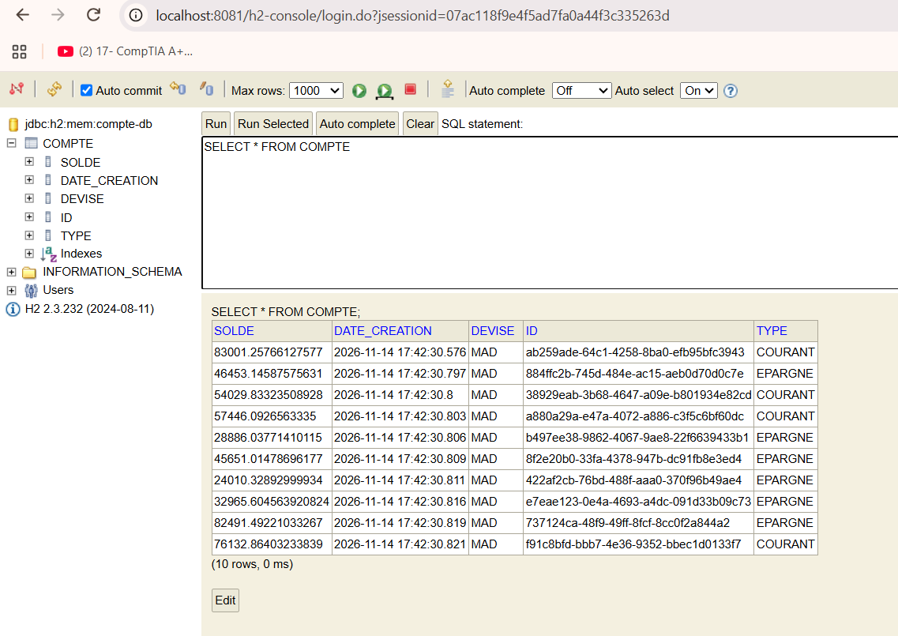
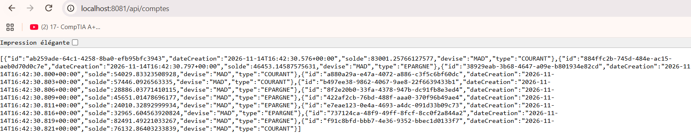
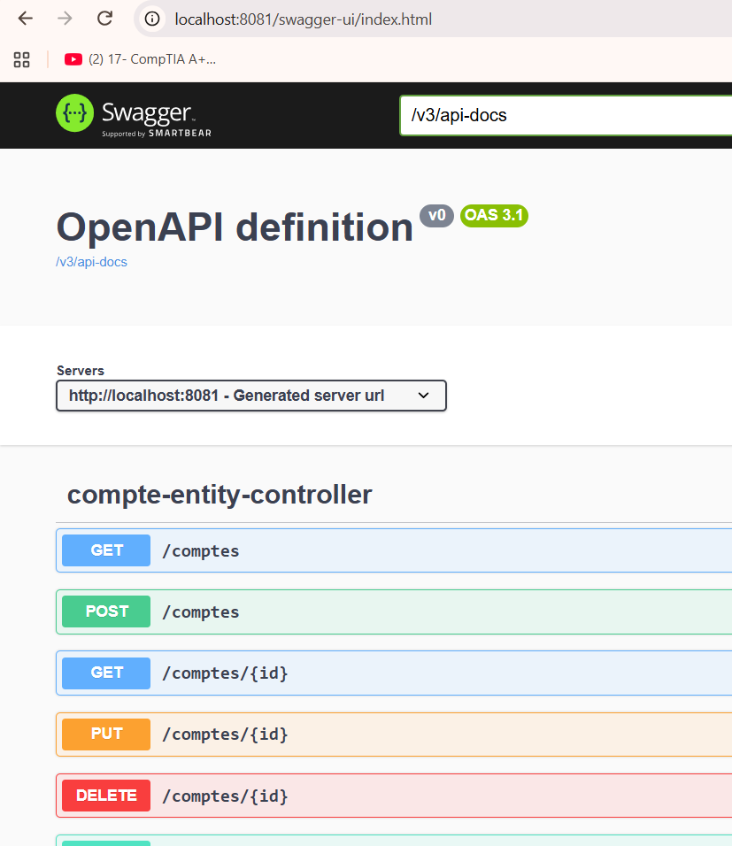
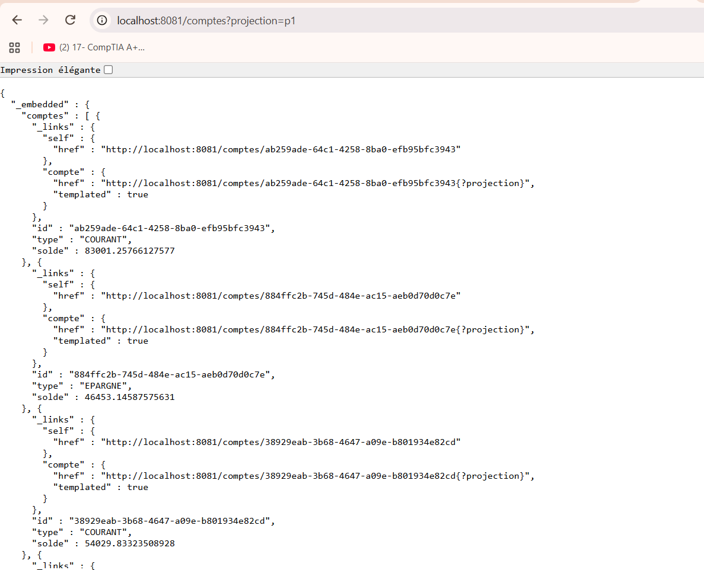
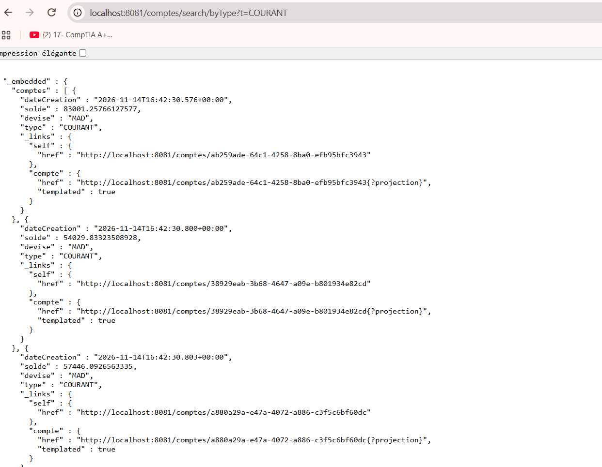
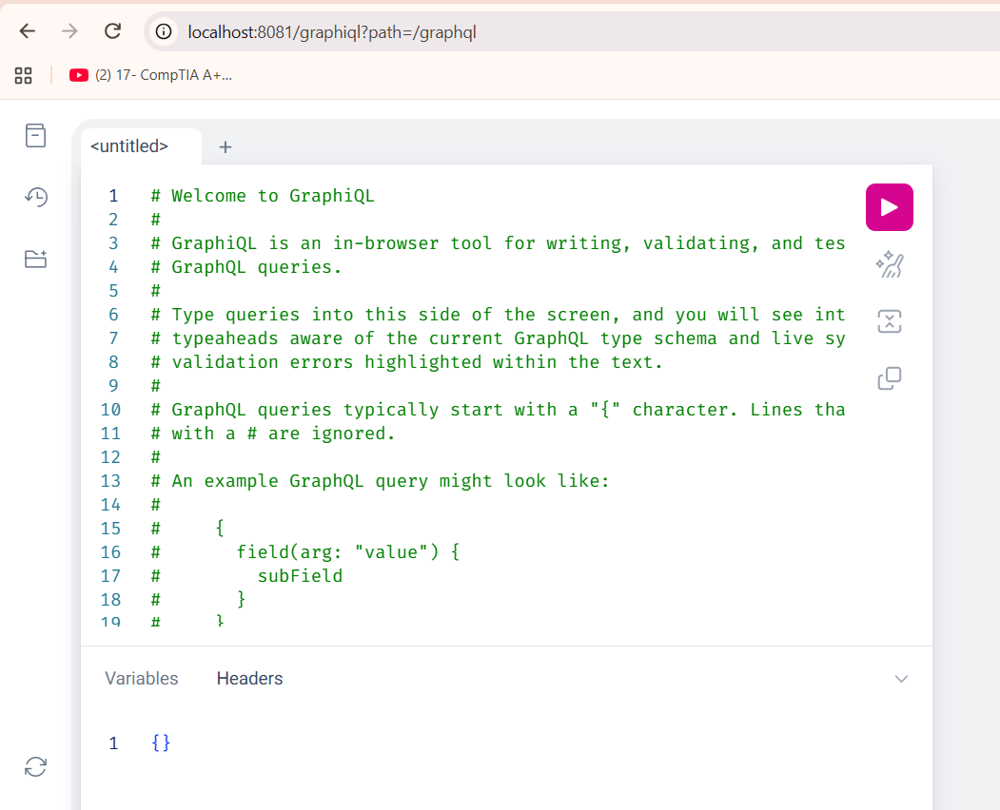
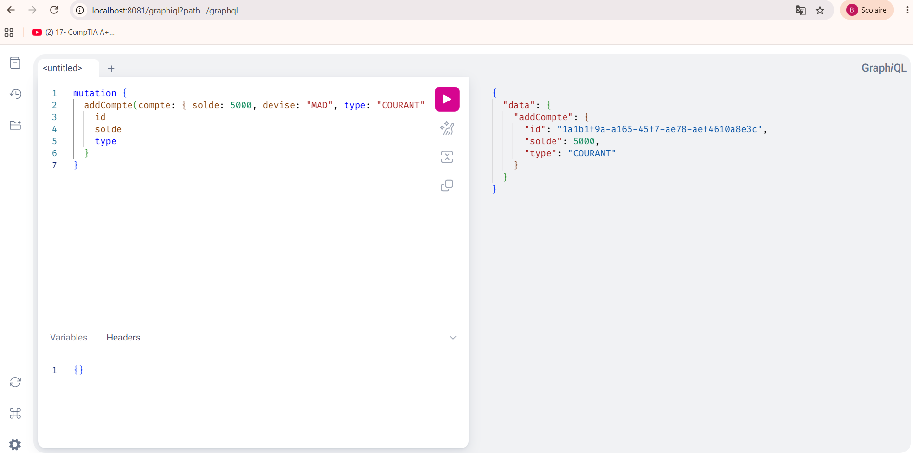

# 🏦 compte-service — Microservice de gestion de comptes bancaires

> **Sujet du TP :** Création d'un microservice de gestion de comptes bancaires (REST, Spring Data REST, Swagger/OpenAPI & GraphQL) avec Spring Boot.

| | |
|---|---|
| **Réalisé par** | Bouchra RAFIK |
| **Établissement** | ENSET |
| **Encadré par** | Pr. Mohamed Youssfi |
| **GroupId / ArtifactId** | `ma.enset.rafik` / `compte-service` |
| **Package racine** | `ma.enset.rafik.compteservice` |

---

## 📑 Sommaire

1. [Objectif du TP & architecture du projet](#1-objectif-du-tp--architecture-du-projet)
2. [Étapes 1 à 4 : couche DAO, entité JPA & base H2](#2-étapes-1-à-4--couche-dao-entité-jpa--base-de-données-h2)
3. [Étapes 5 à 6 : web service RESTful](#3-étapes-5-à-6--web-service-restful-compterestcontroller)
4. [Étape 7 : documentation Swagger UI / OpenAPI](#4-étape-7--documentation-et-test-via-swagger-ui--openapi)
5. [Étape 8 : Spring Data REST & projections](#5-étape-8--spring-data-rest--projections)
6. [Étapes 9 à 10 : DTOs, mappers et couche métier](#6-étapes-9-à-10--dtos-mappers-et-couche-métier-service)
7. [Étape 11 : web service GraphQL](#7-étape-11--web-service-graphql-comptegraphqlcontroller)
8. [Conclusion](#8-conclusion)
9. [Lancer le projet](#-lancer-le-projet)

---

## 1. Objectif du TP & architecture du projet

### 🎯 Objectif

L'objectif est de développer un **microservice autonome** `compte-service`, démarré sur le **port `8081`**, qui gère des comptes bancaires et les expose de plusieurs manières :

- une **API REST** écrite à la main (`@RestController`) ;
- une **API générée automatiquement** par Spring Data REST ;
- une **documentation interactive** OpenAPI via Swagger UI ;
- une **API GraphQL** (queries et mutations).

### 🧰 Stack technique

| Technologie | Rôle |
|---|---|
| **Spring Boot 3.5.6** / **Java 17** | Socle du microservice |
| **Spring Web** | Contrôleurs REST (`@RestController`) |
| **Spring Data JPA** (Hibernate) | Mapping objet-relationnel et repositories |
| **H2 Database** | Base de données en mémoire (`jdbc:h2:mem:compte-db`) |
| **Lombok** | Génération des getters/setters, constructeurs et builder |
| **Spring Data REST** | Exposition automatique des repositories en REST (HATEOAS) |
| **Springdoc OpenAPI 2.8.13** | Documentation OpenAPI 3 + Swagger UI |
| **Spring for GraphQL** | API GraphQL + interface GraphiQL |

### 🗂️ Arborescence du code

```
compte-service/
├── pom.xml
├── README.md
├── screenshots/                       # Captures d'écran du TP
└── src/
    ├── main/
    │   ├── java/ma/enset/rafik/compteservice/
    │   │   ├── CompteServiceApplication.java    # Point d'entrée + CommandLineRunner
    │   │   ├── enums/
    │   │   │   └── TypeCompte.java              # COURANT, EPARGNE
    │   │   ├── entities/
    │   │   │   ├── Compte.java                  # Entité JPA
    │   │   │   └── CompteProjection.java        # Projection Spring Data REST "p1"
    │   │   ├── repositories/
    │   │   │   └── CompteRepository.java        # JpaRepository + @RepositoryRestResource
    │   │   ├── dto/
    │   │   │   ├── CompteRequestDTO.java
    │   │   │   └── CompteResponseDTO.java
    │   │   ├── mappers/
    │   │   │   └── CompteMapper.java            # Entité <-> DTO (BeanUtils)
    │   │   ├── service/
    │   │   │   ├── CompteService.java           # Interface métier
    │   │   │   └── CompteServiceImpl.java       # Implémentation métier
    │   │   └── web/
    │   │       ├── CompteRestController.java    # API REST /api/comptes
    │   │       └── CompteGraphQLController.java # API GraphQL
    │   └── resources/
    │       ├── application.properties
    │       └── graphql/
    │           └── schema.graphqls              # Schéma GraphQL
    └── test/java/ma/enset/rafik/compteservice/
        └── CompteServiceApplicationTests.java
```

### ⚙️ Configuration — `application.properties`

```properties
spring.application.name=compte-service
server.port=8081
spring.datasource.url=jdbc:h2:mem:compte-db
spring.h2.console.enabled=true
spring.graphql.graphiql.enabled=true
```

---

## 2. Étapes 1 à 4 : couche DAO, entité JPA & base de données H2

### 🔹 L'énumération `TypeCompte`

```java
public enum TypeCompte {
    COURANT, EPARGNE
}
```

### 🔹 L'entité JPA `Compte`

```java
@Entity
@Data @NoArgsConstructor @AllArgsConstructor @Builder
public class Compte {
    @Id
    private String id;
    private Date dateCreation;
    private double solde;
    private String devise;
    @Enumerated(EnumType.STRING)
    private TypeCompte type;
}
```

- `@Entity` : la classe est mappée sur la table `COMPTE`.
- `@Id` : la clé primaire est une `String` (un UUID généré par l'application).
- `@Enumerated(EnumType.STRING)` : le type est stocké sous forme de texte (`COURANT` / `EPARGNE`) et non sous forme d'indice numérique, ce qui rend la base plus lisible et plus robuste si l'ordre de l'enum change.
- Les annotations **Lombok** génèrent les getters/setters, `toString`, `equals`/`hashCode` (`@Data`), les constructeurs et le pattern **Builder**.

### 🔹 Le repository `CompteRepository`

```java
@RepositoryRestResource
public interface CompteRepository extends JpaRepository<Compte, String> {
    @RestResource(path = "/byType")
    List<Compte> findByType(@Param("t") TypeCompte type);
}
```

En héritant de `JpaRepository<Compte, String>`, l'interface obtient sans écrire de code les opérations CRUD (`save`, `findAll`, `findById`, `deleteById`…). La méthode `findByType` est une **méthode de requête dérivée** : Spring Data génère la requête JPQL à partir de son nom.

### 🔹 Initialisation des données — `CommandLineRunner`

```java
@Bean
CommandLineRunner start(CompteRepository compteRepository) {
    return args -> {
        for (int i = 0; i < 10; i++) {
            Compte compte = Compte.builder()
                    .id(UUID.randomUUID().toString())
                    .type(Math.random() > 0.5 ? TypeCompte.COURANT : TypeCompte.EPARGNE)
                    .solde(10000 + Math.random() * 90000)
                    .dateCreation(new Date())
                    .devise("MAD")
                    .build();
            compteRepository.save(compte);
        }
    };
}
```

Au démarrage, **10 comptes** sont insérés avec un identifiant UUID, un type aléatoire, un solde aléatoire compris entre 10 000 et 100 000, la date courante et la devise `MAD`.

### 🧪 Test de la base H2

- URL : `http://localhost:8081/h2-console`
- JDBC URL : `jdbc:h2:mem:compte-db`
- User : `sa` / Password : *(vide)*

La requête `SELECT * FROM COMPTE;` affiche les 10 comptes créés au démarrage, avec les colonnes `ID`, `DATE_CREATION`, `SOLDE`, `DEVISE` et `TYPE`.



---

## 3. Étapes 5 à 6 : web service RESTful (`CompteRestController`)

Le contrôleur est annoté `@RestController` et `@RequestMapping("/api")`. Ses dépendances (`CompteRepository`, `CompteService`, `CompteMapper`) sont injectées par le constructeur.

| Méthode HTTP | Endpoint | Action | Retour |
|---|---|---|---|
| `GET` | `/api/comptes` | Liste de tous les comptes | `List<Compte>` |
| `GET` | `/api/comptes/{id}` | Consulter un compte | `Compte` (ou `RuntimeException` : *Compte %s not found*) |
| `POST` | `/api/comptes` | Créer un compte | `CompteResponseDTO` |
| `PUT` | `/api/comptes/{id}` | Modifier un compte | `CompteResponseDTO` |
| `DELETE` | `/api/comptes/{id}` | Supprimer un compte | `void` |

```java
@GetMapping("/comptes")
public List<Compte> comptes() {
    return compteRepository.findAll();
}

@PostMapping("/comptes")
public CompteResponseDTO save(@RequestBody CompteRequestDTO requestDTO) {
    return compteService.addCompte(requestDTO);
}
```

Exemple de corps JSON pour `POST` / `PUT` :

```json
{
  "solde": 25000,
  "devise": "MAD",
  "type": "EPARGNE"
}
```

### 🧪 Test : `GET http://localhost:8081/api/comptes`



La réponse est un tableau JSON qui contient les 10 comptes initialisés au démarrage.

---

## 4. Étape 7 : documentation et test via Swagger UI / OpenAPI

Il suffit d'ajouter la dépendance suivante dans le `pom.xml`. Aucune classe de configuration n'est nécessaire, car Springdoc analyse automatiquement les contrôleurs `@RestController` :

```xml
<dependency>
    <groupId>org.springdoc</groupId>
    <artifactId>springdoc-openapi-starter-webmvc-ui</artifactId>
    <version>2.8.13</version>
</dependency>
```

| Ressource | URL |
|---|---|
| Interface Swagger UI | `http://localhost:8081/swagger-ui.html` |
| Spécification OpenAPI (JSON) | `http://localhost:8081/v3/api-docs` |

Swagger UI liste les endpoints de `compte-rest-controller` ainsi que les ressources générées par Spring Data REST. Le bouton **« Try it out »** permet de tester chaque opération directement depuis le navigateur.



---

## 5. Étape 8 : Spring Data REST & projections

### 🔹 Exposition automatique

Grâce à `@RepositoryRestResource`, Spring Data REST expose **automatiquement** le repository sous `/comptes` (format HAL/HATEOAS, avec pagination et liens `_links`), sans écrire de contrôleur :

| Endpoint | Description |
|---|---|
| `GET /comptes` | Liste paginée des comptes |
| `GET /comptes/{id}` | Un compte |
| `POST` / `PUT` / `PATCH` / `DELETE /comptes/{id}` | Opérations CRUD |
| `GET /comptes/search` | Liste des méthodes de recherche exposées |

### 🔹 Projection `p1`

```java
@Projection(types = Compte.class, name = "p1")
public interface CompteProjection {
    public String getId();
    public TypeCompte getType();
    public double getSolde();
}
```

Une projection permet de choisir les attributs renvoyés au client. Ici, `p1` ne retourne que `id`, `type` et `solde`.

🧪 `GET http://localhost:8081/comptes?projection=p1`



### 🔹 Recherche par type

La méthode `findByType` est exposée grâce à `@RestResource(path = "/byType")`, avec le paramètre `t` défini par `@Param("t")`.

🧪 `GET http://localhost:8081/comptes/search/byType?t=COURANT`



> 💡 Les deux fonctionnalités se combinent : `/comptes/search/byType?t=EPARGNE&projection=p1`.

---

## 6. Étapes 9 à 10 : DTOs, mappers et couche métier (`Service`)

### 🔹 Les DTOs (Data Transfer Objects)

| Classe | Champs | Rôle |
|---|---|---|
| `CompteRequestDTO` | `solde`, `devise`, `type` | Données **envoyées par le client**. L'`id` et la `dateCreation` sont gérés par le serveur. |
| `CompteResponseDTO` | `id`, `dateCreation`, `solde`, `devise`, `type` | Données **renvoyées au client** |

Les DTOs **découplent** le modèle de persistance (l'entité JPA) du contrat de l'API : on peut faire évoluer l'entité sans casser les clients, et le client ne peut pas imposer des champs comme l'`id`.

### 🔹 Le mapper `CompteMapper`

```java
@Component
public class CompteMapper {
    public CompteResponseDTO fromCompte(Compte compte) {
        CompteResponseDTO compteResponseDTO = new CompteResponseDTO();
        BeanUtils.copyProperties(compte, compteResponseDTO);
        return compteResponseDTO;
    }

    public Compte toCompte(CompteRequestDTO requestDTO) {
        Compte compte = new Compte();
        BeanUtils.copyProperties(requestDTO, compte);
        return compte;
    }
}
```

`BeanUtils.copyProperties(source, target)` (Spring) copie automatiquement les attributs qui ont le **même nom et le même type** entre deux objets, ce qui évite d'écrire les getters/setters à la main.

### 🔹 La couche métier `CompteService` / `CompteServiceImpl`

```java
public interface CompteService {
    CompteResponseDTO addCompte(CompteRequestDTO compteDTO);
    CompteResponseDTO updateCompte(String id, CompteRequestDTO compteDTO);
}
```

```java
@Service
@Transactional
public class CompteServiceImpl implements CompteService {
    @Autowired
    private CompteRepository compteRepository;
    @Autowired
    private CompteMapper compteMapper;

    @Override
    public CompteResponseDTO addCompte(CompteRequestDTO compteDTO) {
        Compte compte = Compte.builder()
                .id(UUID.randomUUID().toString())
                .dateCreation(new Date())
                .solde(compteDTO.getSolde())
                .type(compteDTO.getType())
                .devise(compteDTO.getDevise())
                .build();
        Compte savedCompte = compteRepository.save(compte);
        CompteResponseDTO compteResponseDTO = compteMapper.fromCompte(savedCompte);
        return compteResponseDTO;
    }
    // updateCompte(id, compteDTO) : même logique, avec l'id fourni en paramètre
}
```

- `addCompte` génère l'`id` (UUID) et la `dateCreation`, enregistre l'entité, puis la convertit en `CompteResponseDTO`.
- `updateCompte` reconstruit le compte avec l'`id` passé en paramètre, puis appelle `save` (qui fait un *merge* JPA).
- `@Transactional` exécute chaque méthode dans une transaction.

**Flux d'une requête :**

```
Client ──(CompteRequestDTO)──► Controller ──► CompteService ──► CompteRepository ──► H2
Client ◄─(CompteResponseDTO)── Controller ◄── CompteMapper ◄──────── Compte ◄────────┘
```

---

## 7. Étape 11 : web service GraphQL (`CompteGraphQLController`)

### 🔹 Le schéma `src/main/resources/graphql/schema.graphqls`

```graphql
type Query {
    comptesList : [Compte],
    compteById (id : String) : Compte
}

type Mutation {
    addCompte(compte : CompteDTO) : Compte,
    updateCompte(id : String, compte : CompteDTO) : Compte,
    deleteCompte(id : String) : Boolean
}

type Compte {
    id : String,
    dateCreation : String,
    solde : Float,
    devise : String,
    type : String
}

input CompteDTO {
    solde : Float,
    devise : String,
    type : String
}
```

### 🔹 Le contrôleur

| Annotation | Méthode | Implémentation |
|---|---|---|
| `@QueryMapping` | `comptesList()` | `compteRepository.findAll()` |
| `@QueryMapping` | `compteById(@Argument String id)` | `findById(id).orElseThrow(...)` |
| `@MutationMapping` | `addCompte(@Argument CompteRequestDTO compte)` | `compteService.addCompte(compte)` |
| `@MutationMapping` | `updateCompte(@Argument String id, @Argument CompteRequestDTO compte)` | `compteService.updateCompte(id, compte)` |
| `@MutationMapping` | `deleteCompte(@Argument String id)` | `deleteById(id)` puis `return true` |

Le nom de chaque méthode Java correspond au nom du champ déclaré dans le schéma, et `@Argument` lie les arguments GraphQL aux paramètres Java (l'input `CompteDTO` est converti en `CompteRequestDTO`).

### 🧪 Tests sur GraphiQL — `http://localhost:8081/graphiql`

**Query : liste des comptes**

```graphql
query {
  comptesList {
    id
    solde
    devise
    type
  }
}
```

**Query : un compte par id**

```graphql
query {
  compteById(id: "<ID_DU_COMPTE>") {
    id
    dateCreation
    solde
    type
  }
}
```



**Mutation : ajout, modification, suppression**

```graphql
mutation {
  addCompte(compte: { solde: 15000, devise: "MAD", type: "COURANT" }) {
    id
    solde
    devise
    type
  }
}
```

```graphql
mutation {
  updateCompte(id: "<ID_DU_COMPTE>", compte: { solde: 99000, devise: "MAD", type: "EPARGNE" }) {
    id
    solde
    type
  }
}
```

```graphql
mutation {
  deleteCompte(id: "<ID_DU_COMPTE>")
}
```



> 💡 Avec GraphQL, c'est le **client** qui choisit les champs à récupérer, et toutes les opérations passent par un **unique endpoint** `POST /graphql`.

---

## 8. Conclusion

Ce TP montre trois façons d'exposer un même modèle métier dans un microservice Spring Boot :

| Critère | REST (`@RestController`) | Spring Data REST | GraphQL |
|---|---|---|---|
| **Effort de développement** | Moyen : contrôleur écrit à la main | Très faible : généré à partir du repository | Moyen : schéma + contrôleur |
| **Contrôle / logique métier** | ✅ Total (DTOs, service) | ⚠️ Limité (CRUD direct sur l'entité) | ✅ Total (DTOs, service) |
| **Endpoints** | Plusieurs URLs (`/api/comptes/...`) | Plusieurs URLs + HATEOAS (`/comptes`, `/search`) | **Un seul** endpoint `/graphql` |
| **Forme de la réponse** | Fixée par le serveur | Fixée par le serveur (ajustable par projection) | **Choisie par le client** |
| **Over/under-fetching** | Possible | Réduit par les projections | Évité |
| **Documentation** | Swagger / OpenAPI | Swagger / HAL | Schéma typé + introspection (GraphiQL) |
| **Cas d'usage** | API publique, contrat stable | Prototypage rapide, back-office CRUD | Front-ends variés (web/mobile), données imbriquées |

**En résumé :**
- **REST** reste le standard le plus répandu pour la communication entre microservices, avec un contrôle total et une documentation OpenAPI simple à mettre en place.
- **Spring Data REST** fait gagner beaucoup de temps pour exposer du CRUD, mais expose l'entité directement et convient moins à une logique métier complexe.
- **GraphQL** donne au client la flexibilité de choisir ses données et évite les allers-retours multiples, au prix d'un schéma à maintenir.

Grâce à la séparation en couches (**Entité → Repository → Service/DTO/Mapper → Web**), ces trois styles cohabitent dans le même microservice et partagent la même logique métier.

---

## 🚀 Lancer le projet

**Prérequis :** JDK 17+ et Maven (ou IntelliJ IDEA).

```bash
mvn spring-boot:run
```

ou lancer la classe `CompteServiceApplication` depuis l'IDE.

| Service | URL |
|---|---|
| API REST | http://localhost:8081/api/comptes |
| Spring Data REST | http://localhost:8081/comptes |
| Projection p1 | http://localhost:8081/comptes?projection=p1 |
| Recherche par type | http://localhost:8081/comptes/search/byType?t=COURANT |
| Swagger UI | http://localhost:8081/swagger-ui.html |
| OpenAPI JSON | http://localhost:8081/v3/api-docs |
| Console H2 | http://localhost:8081/h2-console |
| GraphiQL | http://localhost:8081/graphiql |

---

<p align="center"><i>TP réalisé par <b>Bouchra RAFIK</b> — ENSET — sous l'encadrement du <b>Pr. Mohamed Youssfi</b></i></p>
